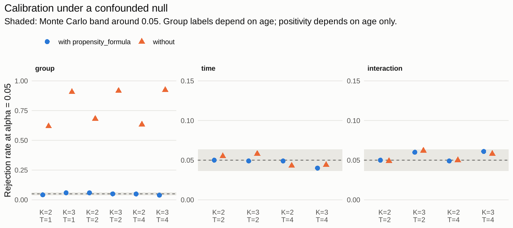
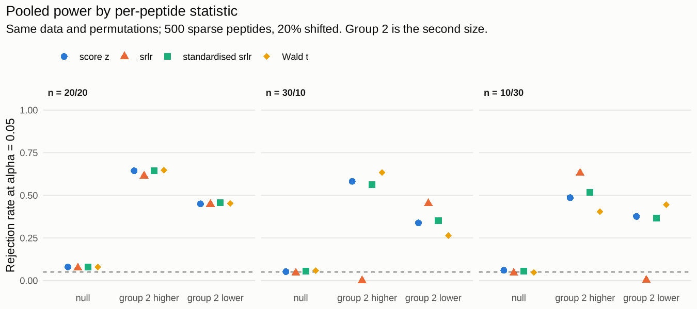
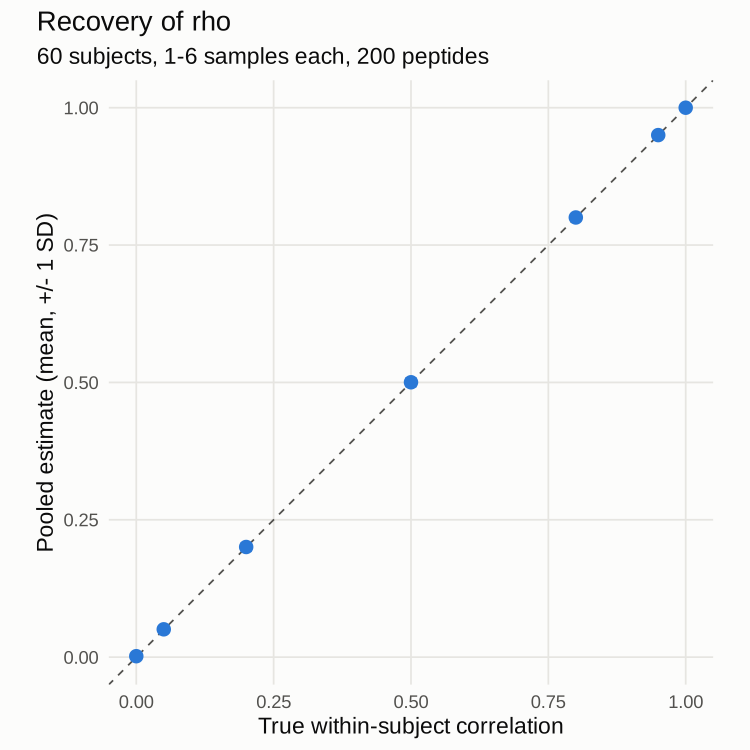

# compute_delta2() validation

Run: 2026-10-19 15:58. Full run; B = 500; cores = 4; phiper 0.4.22.

## Gates

**45 of 50 gates pass; 1 accepted as documented limitations; 4 fail.**

| section | gate | value | lo | hi | status |
|---|---|---|---|---|---|
| 6.1 | K=2, T=1, with PS: group rejection in band | 0.042 | 0.0365 | 0.0635 | pass |
| 6.1 | K=2, T=2, no PS: interaction rejection in band | 0.049 | 0.0365 | 0.0635 | pass |
| 6.1 | K=2, T=2, no PS: time rejection in band | 0.055 | 0.0365 | 0.0635 | pass |
| 6.1 | K=2, T=2, with PS: group rejection in band | 0.059 | 0.0365 | 0.0635 | pass |
| 6.1 | K=2, T=2, with PS: interaction rejection in band | 0.05 | 0.0365 | 0.0635 | pass |
| 6.1 | K=2, T=2, with PS: time rejection in band | 0.05 | 0.0365 | 0.0635 | pass |
| 6.1 | K=2, T=4, no PS: interaction rejection in band | 0.05 | 0.0365 | 0.0635 | pass |
| 6.1 | K=2, T=4, no PS: time rejection in band | 0.043 | 0.0365 | 0.0635 | pass |
| 6.1 | K=2, T=4, with PS: group rejection in band | 0.049 | 0.0365 | 0.0635 | pass |
| 6.1 | K=2, T=4, with PS: interaction rejection in band | 0.049 | 0.0365 | 0.0635 | pass |
| 6.1 | K=2, T=4, with PS: time rejection in band | 0.049 | 0.0365 | 0.0635 | pass |
| 6.1 | K=3, T=1, with PS: group rejection in band | 0.059 | 0.0365 | 0.0635 | pass |
| 6.1 | K=3, T=2, no PS: interaction rejection in band | 0.062 | 0.0365 | 0.0635 | pass |
| 6.1 | K=3, T=2, no PS: time rejection in band | 0.058 | 0.0365 | 0.0635 | pass |
| 6.1 | K=3, T=2, with PS: group rejection in band | 0.05 | 0.0365 | 0.0635 | pass |
| 6.1 | K=3, T=2, with PS: interaction rejection in band | 0.06 | 0.0365 | 0.0635 | pass |
| 6.1 | K=3, T=2, with PS: time rejection in band | 0.049 | 0.0365 | 0.0635 | pass |
| 6.1 | K=3, T=4, no PS: interaction rejection in band | 0.058 | 0.0365 | 0.0635 | pass |
| 6.1 | K=3, T=4, no PS: time rejection in band | 0.044 | 0.0365 | 0.0635 | pass |
| 6.1 | K=3, T=4, with PS: group rejection in band | 0.039 | 0.0365 | 0.0635 | pass |
| 6.1 | K=3, T=4, with PS: interaction rejection in band | 0.061 | 0.0365 | 0.0635 | pass |
| 6.1 | K=3, T=4, with PS: time rejection in band | 0.04 | 0.0365 | 0.0635 | pass |
| 6.2 | 10/30, score: permutation test calibrated | 0.06 | 0.0309 | 0.0691 | pass |
| 6.2 | 10/30, srlr: permutation test calibrated | 0.044 | 0.0309 | 0.0691 | pass |
| 6.2 | 10/30, srlr_std: permutation test calibrated | 0.056 | 0.0309 | 0.0691 | pass |
| 6.2 | 10/30, wald_t: permutation test calibrated | 0.048 | 0.0309 | 0.0691 | pass |
| 6.2 | 20/20, score: permutation test calibrated | 0.08 | 0.0309 | 0.0691 | fail |
| 6.2 | 20/20, srlr: permutation test calibrated | 0.074 | 0.0309 | 0.0691 | fail |
| 6.2 | 20/20, srlr_std: permutation test calibrated | 0.078 | 0.0309 | 0.0691 | fail |
| 6.2 | 20/20, wald_t: permutation test calibrated | 0.08 | 0.0309 | 0.0691 | fail |
| 6.2 | 30/10, score: permutation test calibrated | 0.052 | 0.0309 | 0.0691 | pass |
| 6.2 | 30/10, srlr: permutation test calibrated | 0.044 | 0.0309 | 0.0691 | pass |
| 6.2 | 30/10, srlr_std: permutation test calibrated | 0.054 | 0.0309 | 0.0691 | pass |
| 6.2 | 30/10, wald_t: permutation test calibrated | 0.058 | 0.0309 | 0.0691 | pass |
| 6.3 | (a) residualised interaction calibrated | 0.075 | 0.0365 | 0.0635 | accepted |
| 6.3 | (a) without residualisation the interaction over-rejects | 0.994 | 0.0635 |    1 | pass |
| 6.3 | (a) controls at T1-T2 only: gap warned in every run |    1 |    1 |    1 | pass |
| 6.3 | (b) no dropout: time term calibrated | 0.054 | 0.0365 | 0.0635 | pass |
| 6.3 | (b) informative dropout flagged by the diagnostics in >= 80% of runs |    1 |  0.8 |    1 | pass |
| 6.3 | (b) no dropout: diagnostics silent in >= 95% of runs |    1 | 0.95 |    1 | pass |
| 6.4 | 10 high-turnover vs 50: interaction calibrated | 0.055 | 0.0365 | 0.0635 | pass |
| 6.4 | 50 high-turnover vs 10: interaction calibrated | 0.057 | 0.0365 | 0.0635 | pass |
| 6.5 | (a) |bias| of rho_hat <= 0.05 at rho = 0.05 | 0.000627 | -0.05 | 0.05 | pass |
| 6.5 | (a) |bias| of rho_hat <= 0.05 at rho = 0.2 | 0.000464 | -0.05 | 0.05 | pass |
| 6.5 | (a) |bias| of rho_hat <= 0.05 at rho = 0.5 | 0.000284 | -0.05 | 0.05 | pass |
| 6.5 | (a) |bias| of rho_hat <= 0.05 at rho = 0.8 | 0.000222 | -0.05 | 0.05 | pass |
| 6.5 | (a) |bias| of rho_hat <= 0.05 at rho = 0.95 | 0.000158 | -0.05 | 0.05 | pass |
| 6.6/6.7 | test-delta2_resample.R passes | 0 | 0 | 0 | pass |
| 6.6/6.7 | test-delta2_score.R passes | 0 | 0 | 0 | pass |
| 6.6/6.7 | test-delta2_compute.R passes | 0 | 0 | 0 | pass |

Accepted:

- 6.3 (a) residualised interaction calibrated: Accepted 2026-10-19: the interaction with visits missing at random and a time trend is mildly liberal (about 0.066 over 2400 datasets in three runs); documented in ?compute_delta2 and results/NOTES.md.

## 6.1 Calibration per term

| K | T | propensity | term | n | rejection |
|---|---|---|---|---|---|
|    2 |    1 | no | group | 1000 | 0.618 |
|    2 |    1 | yes | group | 1000 | 0.042 |
|    2 |    2 | no | group | 1000 | 0.681 |
|    2 |    2 | no | interaction | 1000 | 0.049 |
|    2 |    2 | no | time | 1000 | 0.055 |
|    2 |    2 | yes | group | 1000 | 0.059 |
|    2 |    2 | yes | interaction | 1000 | 0.05 |
|    2 |    2 | yes | time | 1000 | 0.05 |
|    2 |    4 | no | group | 1000 | 0.633 |
|    2 |    4 | no | interaction | 1000 | 0.05 |
|    2 |    4 | no | time | 1000 | 0.043 |
|    2 |    4 | yes | group | 1000 | 0.049 |
|    2 |    4 | yes | interaction | 1000 | 0.049 |
|    2 |    4 | yes | time | 1000 | 0.049 |
|    3 |    1 | no | group | 1000 | 0.906 |
|    3 |    1 | yes | group | 1000 | 0.059 |
|    3 |    2 | no | group | 1000 | 0.916 |
|    3 |    2 | no | interaction | 1000 | 0.062 |
|    3 |    2 | no | time | 1000 | 0.058 |
|    3 |    2 | yes | group | 1000 | 0.05 |
|    3 |    2 | yes | interaction | 1000 | 0.06 |
|    3 |    2 | yes | time | 1000 | 0.049 |
|    3 |    4 | no | group | 1000 | 0.923 |
|    3 |    4 | no | interaction | 1000 | 0.058 |
|    3 |    4 | no | time | 1000 | 0.044 |
|    3 |    4 | yes | group | 1000 | 0.039 |
|    3 |    4 | yes | interaction | 1000 | 0.061 |
|    3 |    4 | yes | time | 1000 | 0.04 |

## 6.2 Pooled power by statistic

| sizes | alt | stat | n | rejection | pooled_null_mean |
|---|---|---|---|---|---|
| 10/30 | down | score |  500 | 0.376 | 0.000362 |
| 10/30 | down | srlr |  500 | 0.002 | 2.16 |
| 10/30 | down | srlr_std |  500 | 0.366 | 0.0000259 |
| 10/30 | down | wald_t |  500 | 0.446 | -0.162 |
| 10/30 | null | score |  500 | 0.06 | 0.000577 |
| 10/30 | null | srlr |  500 | 0.044 | 2.17 |
| 10/30 | null | srlr_std |  500 | 0.056 | 0.000596 |
| 10/30 | null | wald_t |  500 | 0.048 | -0.162 |
| 10/30 | up | score |  500 | 0.486 | 0.00194 |
| 10/30 | up | srlr |  500 | 0.63 | 2.17 |
| 10/30 | up | srlr_std |  500 | 0.516 | 0.00146 |
| 10/30 | up | wald_t |  500 | 0.404 | -0.159 |
| 20/20 | down | score |  500 | 0.45 | -0.00324 |
| 20/20 | down | srlr |  500 | 0.448 | -0.00337 |
| 20/20 | down | srlr_std |  500 | 0.456 | -0.00308 |
| 20/20 | down | wald_t |  500 | 0.452 | -0.00326 |
| 20/20 | null | score |  500 | 0.08 | -0.00266 |
| 20/20 | null | srlr |  500 | 0.074 | -0.00288 |
| 20/20 | null | srlr_std |  500 | 0.078 | -0.00265 |
| 20/20 | null | wald_t |  500 | 0.08 | -0.00267 |
| 20/20 | up | score |  500 | 0.644 | 0.000272 |
| 20/20 | up | srlr |  500 | 0.614 | 0.000257 |
| 20/20 | up | srlr_std |  500 | 0.644 | 0.000181 |
| 20/20 | up | wald_t |  500 | 0.648 | 0.000251 |
| 30/10 | down | score |  500 | 0.338 | -0.00297 |
| 30/10 | down | srlr |  500 | 0.452 | -2.18 |
| 30/10 | down | srlr_std |  500 | 0.35 | -0.00279 |
| 30/10 | down | wald_t |  500 | 0.264 | 0.16 |
| 30/10 | null | score |  500 | 0.052 | -0.00133 |
| 30/10 | null | srlr |  500 | 0.044 | -2.18 |
| 30/10 | null | srlr_std |  500 | 0.054 | -0.00114 |
| 30/10 | null | wald_t |  500 | 0.058 | 0.162 |
| 30/10 | up | score |  500 | 0.582 | -0.0000373 |
| 30/10 | up | srlr |  500 | 0 | -2.18 |
| 30/10 | up | srlr_std |  500 | 0.562 | -0.0000683 |
| 30/10 | up | wald_t |  500 | 0.634 | 0.163 |

Exact one-peptide permutation moments:

| n1 | n2 | stat | positives | null_mean | null_sd |
|---|---|---|---|---|---|
|   20 |   20 | score |    1 | 0 | 1.01 |
|   20 |   20 | score |    2 | 0 | 1.01 |
|   20 |   20 | score |    3 | 0 | 1.01 |
|   20 |   20 | score |    5 | 0 | 1.01 |
|   20 |   20 | score |   20 | 0.0000000000000000000176 | 1.01 |
|   20 |   20 | srlr |    1 | 0.000000000000000111 | 1.19 |
|   20 |   20 | srlr |    2 | 0 | 1.18 |
|   20 |   20 | srlr |    3 | 0 | 1.14 |
|   20 |   20 | srlr |    5 | -0.000000000000000513 | 1.07 |
|   20 |   20 | srlr |   20 | 0.00000000000000000000579 | 1.02 |
|   20 |   20 | wald_t |    1 | 0 |    1 |
|   20 |   20 | wald_t |    2 | 0 | 1.01 |
|   20 |   20 | wald_t |    3 | 0 | 1.02 |
|   20 |   20 | wald_t |    5 | 0 | 1.02 |
|   20 |   20 | wald_t |   20 | -0.0000000000000000000112 | 1.03 |
|   10 |   30 | score |    1 | 0.0000000000000000555 | 1.01 |
|   10 |   30 | score |    2 | 0.000000000000000167 | 1.01 |
|   10 |   30 | score |    3 | -0.0000000000000000208 | 1.01 |
|   10 |   30 | score |    5 | 0.00000000000000021 | 1.01 |
|   10 |   30 | score |   20 | 0.000000000000000137 | 1.01 |
|   10 |   30 | srlr |    1 | 0.151 | 1.06 |
|   10 |   30 | srlr |    2 | 0.167 |  1.1 |
|   10 |   30 | srlr |    3 | 0.15 | 1.11 |
|   10 |   30 | srlr |    5 | 0.108 |  1.1 |
|   10 |   30 | srlr |   20 | 0.0000000000000000968 | 1.03 |
|   10 |   30 | wald_t |    1 | -0.0156 | 1.02 |
|   10 |   30 | wald_t |    2 | -0.0114 | 1.02 |
|   10 |   30 | wald_t |    3 | -0.00918 | 1.03 |
|   10 |   30 | wald_t |    5 | -0.00661 | 1.03 |
|   10 |   30 | wald_t |   20 | 0.00000000000000015 | 1.03 |

## 6.3 Unbalanced designs

(a) visits correlated with group:

| scenario | statistic | rejection | n |
|---|---|---|---|
| controls miss 2 of 4 visits at random | interaction, residualised | 0.075 | 1000 |
| controls miss 2 of 4 visits at random | interaction, not residualised | 0.994 | 1000 |
| controls seen at T1-T2 only | interaction, residualised | 0 |  200 |
| controls seen at T1-T2 only | interaction, not residualised |    1 |  200 |

(b) informative dropout:

| dropout | time_rejection | interaction_rejection | flagged |
|---|---|---|---|
| no | 0.054 | 0.043 | 0 |
| yes | 0.416 | 0.053 |    1 |

## 6.4 Interaction robustness

| scenario | interaction_rejection | time_rejection |
|---|---|---|
| 10 high-turnover vs 50 | 0.055 | 0.058 |
| 50 high-turnover vs 10 | 0.057 | 0.038 |

## 6.5 rho

| rho | mean | bias | sd | at_0 | at_1 |
|---|---|---|---|---|---|
| 0 | 0.00169 | 0.00169 | 0.00251 | 0.515 | 0 |
| 0.05 | 0.0506 | 0.000627 | 0.00569 | 0 | 0 |
|  0.2 |  0.2 | 0.000464 | 0.00723 | 0 | 0 |
|  0.5 |  0.5 | 0.000284 | 0.00744 | 0 | 0 |
|  0.8 |  0.8 | 0.000222 | 0.00533 | 0 | 0 |
| 0.95 | 0.95 | 0.000158 | 0.00282 | 0 | 0 |
|    1 |    1 | 0 | 0 | 0 |    1 |

Power by rho option:

| true_rho | option | power |
|---|---|---|
|  0.2 | one | 0.557 |
|  0.2 | pooled | 0.64 |
|  0.2 | zero | 0.623 |
|  0.8 | one | 0.327 |
|  0.8 | pooled | 0.32 |
|  0.8 | zero | 0.29 |

rho per prevalence stratum, phiper example data (phip_mixture):

| stratum | n_peptides | rho_hat |
|---|---|---|
| (0.01, 0.02] |    9 | 0.522 |
| (0.02, 0.05] |  358 | 0.343 |
| (0.05, 0.1] |  898 | 0.27 |
| (0.1, 0.2] |  371 | 0.48 |
| (0.2, 0.5] |  314 | 0.758 |
| pooled | 1950 | 0.493 |

## 6.6 / 6.7 Automated tests

| file | tests | expectations | failed | errors |
|---|---|---|---|---|
| test-delta2_resample.R |   13 |   65 | 0 | 0 |
| test-delta2_score.R |   18 |  116 | 0 | 0 |
| test-delta2_compute.R |    7 |  175 | 0 | 0 |
